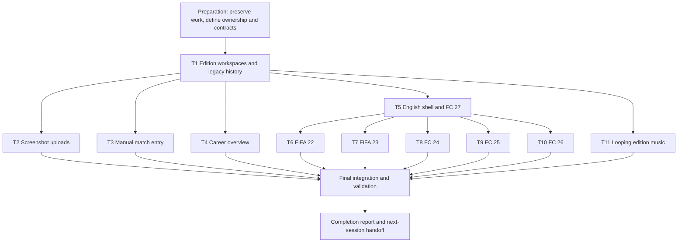

# Parallel execution plan

Status: proposed; awaiting user approval. This document authorizes no implementation on its own.

## Source and current state

- Parent specification: https://github.com/MedAMINE-Hajji/FifaProject-codex/issues/1. Its full body and comments were checked during planning; no comments or child implementation issues exist yet.
- T1 through T11 below refer to the proposed breakdown in the chat, not existing GitHub issue numbers.
- Source checkout: `C:/Users/LENOVO/Documents/GitHub/fifaProject`; branch `main`, HEAD `191d674be5a09daa53b102f03ea71fcc6e41bdd4`, tracking `codex/main`.
- The checkout contains uncommitted edition-related code, the local specification, and user-supplied audio. Preserve that work. The existing schema and UI still default to FIFA 22; audio starts at 80% and multiple editions share one audio association. These partial implementations must be checked against the spec.
- Only one Git worktree currently exists. Managed worktree creation and internal subagent tools are available. Managed worktrees start at a committed revision and do not automatically copy dirty or untracked files.
- The tools and inspected configuration do not expose a verified numeric subagent limit. Plan up to five concurrent implementation workers, subject to actual runtime slots and local resource availability. This is a conservative execution ceiling, not a statement that Codex supports exactly five agents. Queue ready work if fewer slots are available; release finished agents promptly.
- All workers are internal subagents in this chat, with fresh initial prompts. This plan creates no independent Codex chats.

## Dependency graph

Preparation is coordinator-owned work, not an additional feature ticket. It is necessary because the current dashboard and match route contain several workflows in the same files. Separate worktrees alone would not prevent conflicts in those files.

## Batches and assignments

| Batch | Assignment | Prerequisite | Completion gate |
| --- | --- | --- | --- |
| 0 | Coordinator: preparation | User approval | Preserved baseline, known baseline test results, runnable isolation, frozen ownership and interface manifest |
| 1 | Agent A1: T1 | Preparation complete | Legacy backfill and all edition workspaces pass tests and are integrated |
| 2 | Agent A2: T2; Agent A3: T3; Agent A4: T4; Agent A5: T5; Agent A11: T11 | T1 integrated and green | Each worker independently passes its tests and coordinator reviews and integrates its ticket |
| 3 | Agent A6: T6; Agent A7: T7; Agent A8: T8; Agent A9: T9; Agent A10: T10 | T5 integrated and green | Each edition passes its own browser/visual checks and is integrated |
| 4 | Coordinator: complete-system validation and handoff | Every ticket integrated | Full agreed validation passes or any remaining external blocker is explicitly reported |

These are dependency waves, not mandatory full-batch barriers. Once T5 is integrated, a theme worker may use a free slot while another independent Batch 2 worker finishes. At most five implementation workers run concurrently. Start no dependent worker from an unreviewed predecessor branch. Use an updated integration commit containing its accepted prerequisites as the worker's base.

## Preparation and isolation

1. After approval, publish the approved tickets in the Codex repository, link them to spec #1, apply `ready-for-agent`, and record the mapping from T numbers to GitHub issues. Set native blocking relationships when supported; otherwise put explicit blocker references in ticket bodies. Keep the parent's content and state unchanged.
2. Inventory the staged, unstaged, and untracked work. Create an isolated integration worktree and a local checkpoint that includes relevant existing work without changing or cleaning the original checkout. Exclude credentials, generated output, and user MP3s from Git commits. Do not assume HEAD contains the current work.
3. Establish `codex/edition-redesign` as the integration branch. Each ticket gets its own worktree and `codex/edition-tNN` branch from the appropriate accepted integration commit. Record actual absolute paths; do not assume managed worktree locations or write permissions.
4. Install or provision dependencies per worktree. Keep generated Prisma clients and build outputs independent. Give test databases distinct schemas or separate isolated databases, browser servers distinct ports, and test output distinct directories. User audio may be supplied as an untracked local fixture when needed; short deterministic test audio should cover automated behavior.
5. Establish one coordinator-owned browser-test harness and shared API/database fixtures before distributing work. The current repository has Vitest route/validator coverage but no configured standalone browser-test suite. The coordinator owns dependency and lockfile updates.
6. Make the smallest behavior-preserving extraction needed to separate screenshot, manual-entry, career-read, and shell/presentation ownership. Keep the existing public match API as the test boundary. Thin route adapters can delegate to separately owned handlers; avoid introducing extra public endpoints solely for parallelism.
7. Freeze a manifest of exact write allowlists and contracts before dispatch. Stabilize concrete-edition versus aggregate scope, write validation and entry modes, upload context and manual-date handling, dashboard response shapes, mutation refresh callbacks, shell slots, theme capabilities, and audio metadata. T1 can complete and validate those contracts serially before Batch 2 starts.
8. Pre-register theme modules and feature slots while the coordinator owns the registry. Theme workers later edit only their edition module, assets, and tests. Keep each module usable with existing data; incomplete features remain undisplayed until their implementation is integrated.
9. Run baseline tests, lint, type checking, and build checks. Record existing failures separately from regressions. Proceed to parallel work only when contracts and isolation are usable and any baseline failure has a documented cause and disposition.

If separate writable worktrees cannot be provisioned, reduce concurrency to tasks whose exact write sets remain disjoint, or serialize. Different branch names in one directory are not isolated checkouts.

## Common worker packet

Spawn exactly one fresh worker per assigned ticket, with `fork_context: false` and the inherited model. Include only:

- The ticket's final issue identity, complete acceptance criteria, and relevant spec paragraphs. The parent specification remains the authority for disputes.
- The accepted integration base commit, absolute worktree root, exclusive writable files/directories, and the read-only dependencies listed in the per-ticket packet below.
- The frozen request/response/component contracts and relevant prerequisite result summaries; not the whole chat or every other ticket.
- Repository instructions and a requirement to read the relevant installed Next.js guides before changing framework code. Also read applicable glossary/ADRs when present.
- Architecture constraints: one app; six concrete editions; aggregate view cannot own matches; globally shared friends; edition ownership independent of date; user audio URLs authoritative; English interface; existing work preserved.
- Completion rule: implement only the assigned ticket, run its relevant tests and type checks, report exact commands/results, list changed paths, provide commit or patch identity, and disclose failures or follow-ups. The coordinator must review and integrate before the ticket is considered complete.

Workers request changes outside their allowlist from the coordinator rather than editing shared files. They do not create chats, spawn descendants, alter shared dependencies, push branches, modify tracker state, or use the live database.

## File ownership and per-ticket packets

Paths below are relative to each worker's assigned absolute repository root. Existing paths identify read context. Proposed namespaces are planning targets; the coordinator finalizes the exact manifest during preparation. They are not files already implemented.

Shared files have one writer: the coordinator owns the top-level page composition, route adapters, root layout, shared global styles, edition registry, schema after T1, package/lockfiles, common test setup, and shared contracts. Registry wiring occurs serially. No two workers receive overlapping writable files, even when changes would affect different functions within the same file.

### A1 / T1: edition workspaces and legacy history

- Spec focus: stories 1-4, 15-19, 31-35; edition identity, legacy backfill, strict write scope, consistent aggregates and stale-response protection.
- Relevant existing sources: `prisma/schema.prisma`, `lib/fifa-editions.ts`, `app/api/matches/route.ts`, `app/api/matches/[id]/route.ts`, dashboard state and edition selector, current match validation and tests.
- Exclusive scope during this serial batch: edition model/catalog, migration, shared match contracts, core match read/write services, workspace data orchestration, and their tests. Coordinator integration edits pause while A1 owns them. Handoff of these shared files occurs before Batch 2.
- Acceptance: fresh visits open FC 27; confirmed legacy records move safely and repeatably to FC 27 with all other data preserved; genuine classified records outside the legacy cohort survive; six edition histories and every aggregate are isolated; friends remain shared; invalid or aggregate edition writes fail; empty editions show zeroes; edits/deletes refresh correctly; delayed responses cannot replace a newer selection.
- Tests: isolated-persistence route scenarios across editions sharing friends, idempotent backfill, invalid editions, empty data, mutation refresh, rapid-switch browser scenario, and legacy regression coverage.

### A2 / T2: screenshot upload context

- Spec focus: stories 11, 20-25; captured edition/upload time preserved through analysis and review.
- Relevant existing sources: `app/api/matches/analyze/route.ts`, upload/review/save logic from `app/page.tsx`, `lib/match-stats.ts`, and `tests/analyze-route.test.ts`. After extraction, consume the common write contract read-only.
- Exclusive scope: extracted screenshot/import dialog, upload/analyzer handler and upload-context adapter, feature-local messages, upload tests. Do not edit the common match dispatcher or manual-entry handler.
- Acceptance: capture selected concrete edition and server upload time; retain both across edition switching and midnight; review before save; valid results persist into the correct edition; analysis/save failures preserve existing records; errors and controls are English.
- Tests: multipart route tests with deterministic AI responses; rejected/invalid images and scores; midnight-crossing delayed save; browser upload-switch-review-save scenario.

### A3 / T3: manual match entry

- Spec focus: stories 26-30; selected edition plus user-selected date, independent of release/calendar year.
- Relevant sources: frozen write contract, shared validator and friend-selection interface, existing match form behavior. Read screenshot entry's public contract, not its private implementation.
- Exclusive scope: new manual-entry dialog, manual-entry validation/date adapter behind the common match API, and manual tests.
- Acceptance: choose or create a shared friend, enter clubs/scores and optional stats, choose a required valid date, save into selected concrete edition, refresh data; preserve the chosen calendar day across reload/timezone cases; retain dates on unrelated edits; all copy English.
- Tests: manual-write API scenarios, invalid dates/scores, aggregate-scope rejection, dates unrelated to edition years, and browser save/reload checks across timezone settings.

### A4 / T4: career overview and comparisons

- Spec focus: stories 37-40; lifetime totals, per-edition comparisons, and shared friend identities.
- Relevant sources: T1's scoped read service, dashboard response contract, friend statistics and history components.
- Exclusive scope: career overview panel, aggregate/comparison read handler behind the common list interface, career-local styles/messages, and career tests.
- Acceptance: union counts each record once; show explicit edition comparisons and lifetime rivalry records; all-edition view cannot own a match; entry from it asks for a concrete edition; aggregate refresh after mutations remains accurate.
- Tests: multi-edition API fixtures, empty career state, one friend across editions, combined totals after mutation, and browser scope/entry checks. Existing audio scope is retained on the career view rather than inventing a seventh edition.

### A5 / T5: English shell and authentic FC 27

- Spec focus: stories 5-14, 31, 36; shared English presentation, responsive accessibility, authentic FC 27 treatment.
- Relevant sources: `app/layout.tsx`, `app/globals.css`, extracted dashboard and management components, edition selector and frozen theme/slot interfaces. Shared integration points are read-only to the worker.
- Exclusive scope: shared dashboard-shell presentation modules, FC 27 theme module/assets, existing management presentation and shared UI messages, and shell/FC 27 tests. Feature workers own English strings in their own new features. Coordinator handles root/global or route translations through serial integration, not concurrent edits.
- Acceptance: recognizable FC 27 atmosphere beyond a color swap; functional phone/desktop layouts; English existing controls, feedback, and date/result presentation; keyboard/focus/reduced-motion behavior; explicit cross-edition effect before destructive shared-friend deletion. Freeze the theme interface before accepting T5.
- Tests: FC 27 visual/browser checks, navigation/form usability at representative widths, keyboard/accessibility checks, friend-deletion confirmation and management regression checks.

### A6-A10 / T6-T10: individual edition experiences

| Worker | Ticket | Edition | Exclusive feature namespace | Acceptance and tests |
| --- | --- | --- | --- | --- |
| A6 | T6 | FIFA 22 | `app/editions/fifa22/`, its edition assets and tests | Actual-menu reference informs backgrounds, typography, cards, transitions; scoped records and core actions remain usable; phone/desktop screenshots, keyboard and reduced-motion checks |
| A7 | T7 | FIFA 23 | `app/editions/fifa23/`, its edition assets and tests | Same acceptance for FIFA 23, with a recognizably distinct identity |
| A8 | T8 | FC 24 | `app/editions/fc24/`, its edition assets and tests | Same acceptance for FC 24, with a recognizably distinct identity |
| A9 | T9 | FC 25 | `app/editions/fc25/`, its edition assets and tests | Same acceptance for FC 25, with a recognizably distinct identity |
| A10 | T10 | FC 26 | `app/editions/fc26/`, its edition assets and tests | Same acceptance for FC 26, with a recognizably distinct identity |

Each worker receives only its edition's reference brief plus the accepted T5 theme contract, common data/control interfaces, stories 5-7 and 10-14, its exact asset/test allowlist, and its ticket criteria. Read the accepted shell and catalog; edit neither. Changes required in shared markup go through the coordinator and must be integrated before dependent checks pass. Theme tests exercise real selected-edition content, not only isolated decorative swatches.

### A11 / T11: edition music

- Spec focus: stories 41-50; stable audio URLs, one looping track per edition, media lifecycle and controls.
- Relevant sources: `app/components/EaTraxPlayer.tsx`, read-only edition identities, frozen concrete-edition/career-scope contract, and local audio availability. The current user MP3 is an input, not a file to rewrite or commit.
- Exclusive scope: music player and its local styles, extracted audio catalog/metadata, deterministic audio fixtures and music tests. Read the edition registry; coordinator registers the audio association once.
- Acceptance: use the six agreed edition MP3 URLs; exactly one looping track each; 15% initial volume; remembered user controls; explicit fallback after blocked autoplay; fade switching without overlap; deliberate pause survives switching; background pause; career retains prior concrete edition's song; missing media leaves the app usable and reports honest status. Metadata reflects supplied recordings.
- Tests: browser media fixtures for each URL, rejected playback, missing/unreadable files, loop, volume, preference persistence, switching, manual pause and document visibility; use short fixtures rather than relying on real songs or external streaming.

## Integration and validation

1. Verify every returned diff stays within its allowlist and meets its acceptance criteria. Review migration and date behavior explicitly; a completed agent is not automatically an accepted ticket.
2. Integrate one ticket at a time into the integration branch. Resolve conflicts centrally, rerun affected checks, and update the accepted base commit. Shared files are not bulk-merged blindly.
3. Dispatch newly ready work only after its prerequisite commit is integrated and the relevant checks pass. Record the dependency state and close completed workers to release slots.
4. Bound local resource-heavy work separately from agent count: initially allow at most two browser servers/test runs and one production build at once. Use independent test database schemas/ports/output. Reduce this further on resource pressure.
5. On the combined branch, run the configured test suite, lint, TypeScript checking, Prisma schema/client checks as applicable, and production build. Run isolated-database migration and end-to-end acceptance scenarios covering all entry methods, all six editions, career comparisons, English UI, friend management, and complete media lifecycle.
6. Perform final phone/desktop visual review for every edition. Distinct colors alone do not establish menu authenticity. Check keyboard navigation and reduced motion after all themes and forms are integrated.
7. Report actual commands and outcomes, including external blockers such as an unavailable isolated database or missing audio. Do not describe unrun checks as passing. Do not use the production database or a paid live model to make tests pass.
8. Record issue completion only after integration and validation. No deployment or live-data migration is included without separate authorization. Restrict repository writes/pushes to the Codex version as authorized; keep the original/Gemini comparison untouched.

## Next-session handoff

Planning handoff now: spec #1 is published; 11 ticket proposals and this execution plan await approval. No implementation workers, ticket issues, branches, or worktrees have been created for this plan. The original checkout is dirty and must be preserved. The next action is to obtain plan approval, then perform coordinator preparation and issue publication before dispatching A1.

Completion handoff later: record the integration branch and commit, actual worktree paths, T-to-issue mapping, accepted versus pending tickets, dependency frontier, migrations and their test status, test commands/results, audio availability, unresolved risks, and the exact next action. Never rely on an agent nickname or this chat's history as the only source of unfinished-work context.
### Reasoning Effort & Token Optimization
- Coordinator: High reasoning effort.
- Subagents: Medium by default; High for complex architecture, security, or debugging.
- Maximize safe parallelism, not agent count.
- Give each agent minimal, task-specific context.
- Avoid overlapping file changes and redundant repository reads.
- Escalate reasoning effort only when necessary.
- Verify actual Codex settings; Markdown instructions alone don't configure effort.
